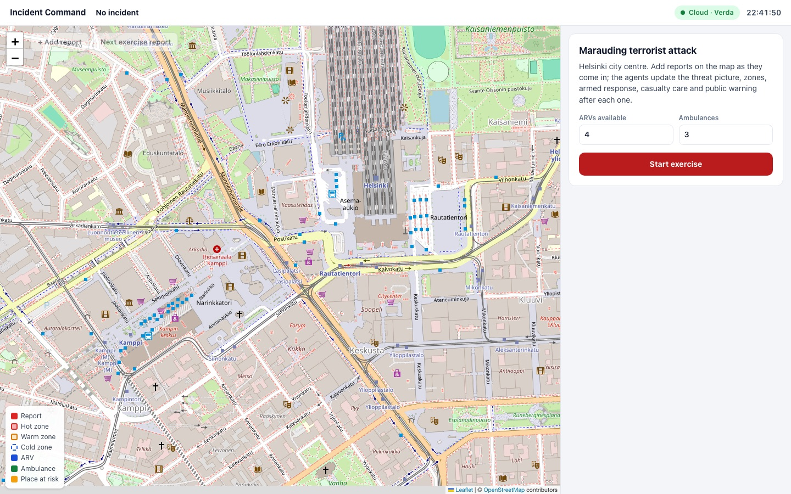
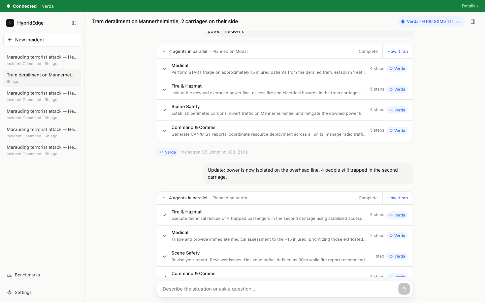

# HybridEdge

Multi-agent AI for first responders that keeps working when the network drops.

Agents run on a cloud GPU while there is a link and carry on, on the laptop, when there
isn't. Every agent step is checkpointed on the device, so a lost connection, a crashed
provider or a closed browser costs nothing that was already done.



Built for Junction 2026 on NVIDIA Nemotron: **Nemotron 3.5 Lightning 30B-A3B** in the cloud
(vLLM on an H100, on Verda with Modal as standby) and **Nemotron 3.5 Bolt E4B** on a
MacBook Air M3 (Ollama).

## Results

On the same benchmark items, with the cloud link cut mid-answer on 30% of them:

| | GSM8K | BFCL simple | BFCL multiple | BFCL parallel |
|---|---|---|---|---|
| **HybridEdge** | **98.3%** | **100%** | **97.5%** | **82.5%** |
| Cloud only (cut answers lost) | 66.7% | 58.5% | 62.4% | 50.3% |
| Device only | 91.7% | 100% | 97.5% | 82.5% |

- All 180 answers were delivered. A cloud-only agent would have lost 66.
- A dropped link is detected in about 60 ms. The device is writing the same answer again in about 4 s (median).
- A durable checkpoint costs about 1 ms per step.
- The full five-adviser incident workflow delivered a brief in all four network scenarios, from 30 s (cloud up) to 48 s (link lost mid-run).

Method, raw numbers and how to reproduce them: [docs/benchmarks.md](docs/benchmarks.md).

## How it works

```
                ┌──────────────── laptop (source of truth) ────────────────┐
 Browser ─SSE── │ FastAPI ── LangGraph workflow ── SQLite checkpoints       │
 other apps ─── │ /v1 Agents API     │                                      │
                │                Router: Verda → Modal → this device        │
                └────────────────────┬──────────────┬──────────────┬───────┘
                                     │              │              │
                          Verda H100 (vLLM)  Modal H100 (vLLM)  Ollama on M3
                          Lightning 30B      cold standby       Bolt E4B
```

- **One workflow, two shapes.** A lead agent plans, specialists work in parallel with their
  own tool loops, a reviewer checks the plan and sends issues back, and the lead writes the
  brief. In the cloud, up to five specialists run at once. On the device, the small model
  still plans: it ranks the specialists, runs the core two, and defers the rest.
- **Routing per step, not per task.** Each model call goes to the best target at that
  moment. A run can start on Verda, overflow to Modal and finish on the laptop.
- **Failover mid-answer.** Losing the network cuts cloud streams at once. The step re-runs
  on the device from the last checkpoint. When the cloud returns, a running device step
  moves back up and deferred specialists run in the cloud.
- **Nothing is redone.** Finished specialists are stored as pending writes, so a resumed
  run only executes the unfinished ones.

More detail: [docs/architecture.md](docs/architecture.md).



## Run it

You need [uv](https://docs.astral.sh/uv/), [Ollama](https://ollama.com) and at least one
OpenAI-compatible endpoint serving Nemotron 3.5 Lightning. See [docs/deploy.md](docs/deploy.md).

```bash
cp .env.example .env      # add your endpoint URLs and keys
./start.sh                # pulls the on-device model on first run
```

| URL | What it is |
|---|---|
| http://localhost:8787 | Console: incidents, live agent progress, settings, benchmarks |
| http://localhost:8787/command/ | Incident Command: a marauding-attack exercise on a live map |
| http://localhost:8787/docs | Agents API reference |

To try the offline path, open the connection menu (Incident Command, top right) or
**Settings → Test mode** and simulate losing the network. Or turn off Wi-Fi.

## Agents API

Other apps on the device use the same checkpointed, failover-aware agents through a
Responses-style API. Every session also appears live in the console.

```bash
curl -N localhost:8787/v1/responses -H 'content-type: application/json' -d '{
  "agent": "mta", "stream": true,
  "input": "Two attackers with knives at Narinkka Square, moving east. Produce the commander'\''s brief."}'
```

Endpoints and events: [docs/agents-api.md](docs/agents-api.md).

## Repository layout

```
hybridedge/   server, router, LangGraph workflow, tools, Agents API
web/          console and Incident Command (plain HTML/CSS/JS, no build step)
bench/        benchmark scripts and the latest results
deploy/       Modal deployment
tests/        unit tests (no models or network needed)
docs/         architecture, benchmarks, API, deployment
```

## Development

```bash
uv sync
uv run pytest
```

## Limitations

- The protocol cards, hospital capacities and unit numbers are demo data. Local procedures
  and command decisions always take precedence.
- The device model is small: it runs a reduced team, and its reports are shorter.
- Benchmarks use the first 40 to 60 items of each set, so treat differences of a few points
  as noise.

## Licence

[MIT](LICENSE)
