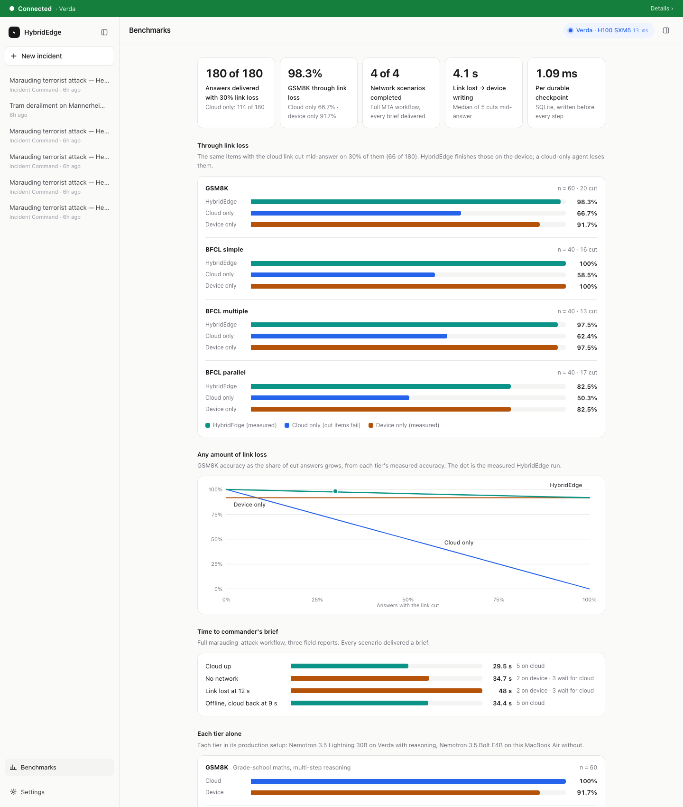

# Benchmarks

All numbers come from `bench/results.json` and are shown in the console under
**Benchmarks** (http://localhost:8787/#benchmarks).



## Setup

| Tier | Model | Where | Settings |
|---|---|---|---|
| Cloud | Nemotron 3.5 Lightning 30B-A3B (BF16) | vLLM 0.27.1, 1× H100 SXM5 on Verda | reasoning on |
| Device | Nemotron 3.5 Bolt E4B (NVFP4) | Ollama, MacBook Air M3, 16 GB | reasoning off |

Each tier runs as HybridEdge uses it in production. Temperature 0.

- **GSM8K**: the first 60 problems of the test set, scored on the final number.
- **BFCL v3**: the first 40 items of the `simple`, `multiple` and `parallel` categories,
  scored by AST match (function name, required arguments, allowed values, any call order),
  following the official checker. No system prompt, as in the official protocol.

## Through link loss

`bench/hybrid.py` replays the same items through the HybridEdge failover path. On a random
30% of items (fixed seed), the cloud answer is started and the link is cut 1 to 4 s in. The
item is then answered on the device, as the router does when a stream is lost.

| | GSM8K | BFCL simple | BFCL multiple | BFCL parallel |
|---|---|---|---|---|
| Items cut | 20 / 60 | 16 / 40 | 13 / 40 | 17 / 40 |
| **HybridEdge** (measured) | **98.3%** | **100%** | **97.5%** | **82.5%** |
| Cloud only | 66.7% | 58.5% | 62.4% | 50.3% |
| Device only (measured) | 91.7% | 100% | 97.5% | 82.5% |

"Cloud only" is the measured cloud accuracy on the same items multiplied by the share of
items whose link stayed up: without a fallback, a cut answer is lost.

The "Any amount of link loss" chart extends this to every cut rate: cloud only is
`c × (1 − p)`, HybridEdge is `c × (1 − p) + d × p`, from the measured per-tier accuracies
`c` and `d`. The dot is the measured run.

## Each tier alone

| | Cloud | Device |
|---|---|---|
| GSM8K (60) | 100% | 91.7% |
| BFCL simple (40) | 97.5% | 100% |
| BFCL multiple (40) | 92.5% | 97.5% |
| BFCL parallel (40) | 87.5% | 82.5% |

On larger samples the cloud scored 93.5% on GSM8K (200 items) and 98% / 94% / 88% on BFCL
simple / multiple / parallel (100 items each).

## System

`bench/system.py`, against the running server:

- **Failover**: a single-agent task is cut while the agent is writing. The cut is detected
  in 57 ms (median of 5), and the device is writing the same answer again after 4.1 s
  (median), including the device re-reading the prompt. All 5 answers completed.
- **Checkpoint cost**: a 200-step LangGraph run with `durability="sync"` on SQLite, against
  the same graph without a checkpointer: 1.09 ms per step.
- **Network scenarios**: the five-adviser marauding-attack workflow on three field reports.

| Network | Brief done | Advisers |
|---|---|---|
| Cloud up | 29.5 s | 5 on cloud |
| No network | 34.7 s | 2 on device, 3 waiting for the cloud |
| Link lost at 12 s | 48 s | 2 on device, 3 waiting for the cloud |
| Offline, cloud back at 9 s | 34.4 s | 5 on cloud (3 handed back) |

## Reproduce

```bash
uv run python bench/models.py --tier cloud  --gsm8k 60 --bfcl 40
uv run python bench/models.py --tier device --gsm8k 60 --bfcl 40
uv run python bench/hybrid.py --outage 0.3
uv run python bench/system.py              # needs ./start.sh running
```

The datasets are fetched once into `datasets/bench/` (gitignored):

```bash
mkdir -p datasets/bench && cd datasets/bench
curl -LO https://raw.githubusercontent.com/openai/grade-school-math/master/grade_school_math/data/test.jsonl && mv test.jsonl gsm8k_test.jsonl
for c in simple multiple parallel; do
  curl -LO https://huggingface.co/datasets/gorilla-llm/Berkeley-Function-Calling-Leaderboard/resolve/main/BFCL_v3_$c.json
  curl -L -o ans_BFCL_v3_$c.json https://huggingface.co/datasets/gorilla-llm/Berkeley-Function-Calling-Leaderboard/resolve/main/possible_answer/BFCL_v3_$c.json
done
```

## Caveats

- Samples are small (40 to 60 items per set). Differences of a few points are noise; the
  device beating the cloud on BFCL simple and multiple is within that noise.
- Link loss is injected by the benchmark, not by real radio conditions.
